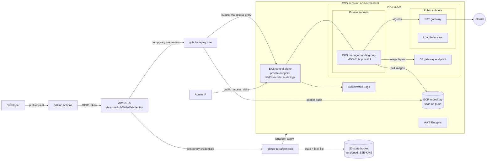

# aws-platform-terraform

Terraform for a production-style **AWS foundation for containerized apps**. It builds a VPC across three AZs, an EKS cluster with private nodes, an ECR repository for images, and keyless GitHub Actions CI/CD through IAM OIDC federation. There are separate **dev** and **prod** environments built from the same small modules. The default region is `ap-southeast-3` (Jakarta).

> Status: portfolio / reference project. Formatting, validation, linting and security scanning run in CI. Nothing here has been applied against a real AWS account as part of this repository; see [Verification](#verification).

## What it builds

| Module | Resources |
|--------|-----------|
| [`vpc`](modules/vpc) | VPC over 3 AZs, public + private subnets with EKS load balancer tags, NAT gateway(s), S3 gateway endpoint, optional flow logs, default security group locked down |
| [`eks`](modules/eks) | **EKS** cluster: private endpoint (+ optional allow-listed public endpoint), KMS-encrypted Secrets, control-plane logs, access entries (no `aws-auth`), managed node group in private subnets (IMDSv2, encrypted gp3), managed add-ons incl. **Pod Identity** agent |
| [`ecr`](modules/ecr) | Repository with scan on push, KMS encryption, optional immutable tags, lifecycle policy |
| [`github-oidc`](modules/github-oidc) | IAM OIDC provider for GitHub, a **deploy** role and a **Terraform** role, each trusted only for specific repo + branch/environment `sub` claims (no access keys) |
| [`budget`](modules/budget) | Optional monthly cost budget with email alerts |

`bootstrap/` creates the S3 bucket that holds the remote state.

### dev vs prod

| Setting | dev | prod |
|---------|-----|------|
| VPC CIDR | `10.10.0.0/16` | `10.20.0.0/16` |
| NAT gateways | **1** shared | **1 per AZ** (3) |
| VPC flow logs | off | on, 90 days |
| EKS deletion protection | off | **on** |
| EKS public endpoint | your IP only (`public_access_cidrs`) | off by default (private only) |
| Control-plane log types | api, audit, authenticator | all five |
| Control-plane log retention | 7 days | 90 days |
| Nodes | `t3.medium`, 1–3 (2 at start), 30 GiB | `m6i.large`, 3–6, 50 GiB |
| ECR immutable tags | off | **on** |
| ECR `force_delete` | on | off |
| Images kept | 10 | 30 |
| Deploy role trusted for | app repo `main` branch | app repo `prod` GitHub environment |
| Default budget (if enabled) | 250 USD | 1000 USD |
| CI apply | automatic on merge | after a **required reviewer** approves |

## Architecture



## Repository layout

```
bootstrap/            # one-time: S3 state bucket
envs/dev, envs/prod   # root modules: module wiring, S3 backend, provider default_tags
modules/              # vpc, eks, ecr, github-oidc, budget
.github/workflows/    # fmt / validate / tflint / checkov, plan on PR, apply on main
```

## Prerequisites

- An AWS account. One account per environment is recommended, but a single account works (see the prod `terraform.tfvars.example`)
- Admin credentials for the **first** apply, which you run locally. For example, an IAM Identity Center admin role through `aws sso login`
- [Terraform](https://developer.hashicorp.com/terraform/install) >= 1.10 (tested with 1.15), [AWS CLI v2](https://docs.aws.amazon.com/cli/latest/userguide/getting-started-install.html) and kubectl
- Optional: [tflint](https://github.com/terraform-linters/tflint) and [Checkov](https://www.checkov.io/) for `make lint` / `make scan`

```bash
aws sso login --profile admin
export AWS_PROFILE=admin
aws sts get-caller-identity
```

## Getting started

### 1. Bootstrap the state bucket

```bash
cd bootstrap
cp terraform.tfvars.example terraform.tfvars   # set a globally unique bucket_name
terraform init
terraform apply
```

The bucket has versioning, SSE-KMS with an S3 Bucket Key, all four public-access blocks, ACLs disabled (`BucketOwnerEnforced`), a bucket policy that denies non-TLS requests, expiry of old versions after 90 days, and `prevent_destroy`. Bootstrap keeps its own state **locally**, because it creates the bucket that would otherwise hold that state. Keep `bootstrap/terraform.tfstate` somewhere safe, or move it into the bucket afterwards: add a `backend "s3" { key = "bootstrap/terraform.tfstate", use_lockfile = true }` block and run `terraform init -migrate-state`.

#### Why S3 native locking instead of DynamoDB

Since Terraform 1.10, the S3 backend can lock state by itself. With `use_lockfile = true` it writes a `terraform.tfstate.tflock` object next to the state using a **conditional write** (`If-None-Match`). If the object already exists, the second writer fails and waits. Compared with the older DynamoDB lock table:

- There is one fewer resource to create, secure, pay for and grant IAM access to. Locking uses the same bucket and the same `s3:PutObject`/`s3:DeleteObject` permission on the same key prefix
- Bootstrap is simpler, and there is no table whose name must match in every backend config
- HashiCorp has deprecated DynamoDB-based locking and plans to remove it in a future release

### 2. Configure an environment

```bash
cd envs/dev
cp backend.hcl.example backend.hcl                 # bucket + region from step 1
cp terraform.tfvars.example terraform.tfvars       # account_id, github_repository, your IP, admin role
```

- `public_access_cidrs` decides who can reach the Kubernetes API over the internet. Use your own public IP as a `/32`. If the list is empty, the endpoint is private-only and you need a VPN, bastion or SSM session inside the VPC to use `kubectl`. Terraform itself only calls AWS APIs, so it works either way
- `cluster_admin_arns` lists the IAM roles that get `AmazonEKSClusterAdminPolicy` through access entries. The cluster creator gets **no** implicit admin rights, so add your own role here
- `allowed_account_ids` in the provider stops you from applying dev with prod credentials, or the other way round

### 3. Plan and apply dev

```bash
make plan ENV=dev                       # init with backend.hcl + plan -out=tfplan
terraform -chdir=envs/dev apply tfplan
```

Creating the cluster and node group takes about 15–20 minutes. Then:

```bash
$(terraform -chdir=envs/dev output -raw update_kubeconfig_command)
kubectl get nodes
```

### 4. Let CI take over

The first apply created the Terraform role for each environment. It already has access to its own state prefix (`envs/dev/*`), and nothing else in the bucket.

1. In GitHub, go to **Settings → Secrets and variables → Actions → Variables** and add these repository variables. None of them are secrets.

   | Variable | Value |
   |----------|-------|
   | `AWS_REGION` | `ap-southeast-3` |
   | `DEV_TF_ROLE_ARN` / `PROD_TF_ROLE_ARN` | output `terraform_role_arn` |
   | `DEV_TF_STATE_BUCKET` / `PROD_TF_STATE_BUCKET` | bucket from step 1 (the same one if both envs share an account) |
   | `DEV_TFVARS` / `PROD_TFVARS` | the full contents of that env's `terraform.tfvars`; CI writes it back to disk before `init` |

2. In **Settings → Environments**, create `dev` and `prod`. On `prod`, enable **Required reviewers**, add yourself or your team, and restrict deployment branches to `main`.

Repeat steps 2–4 for `envs/prod`. If both environments share one account, keep `create_github_oidc_provider = false` in prod, because the OIDC provider is account-wide and dev already created it.

## CI/CD workflow

[`.github/workflows/terraform.yml`](.github/workflows/terraform.yml)

| Trigger | Job | What it does |
|---------|-----|--------------|
| PR and push | `checks` (bootstrap, dev, prod) | `terraform fmt -check`, `init -backend=false`, `validate`, `tflint` (aws ruleset), Checkov |
| PR (same repo) | `plan` (dev, prod) | Assumes the Terraform role through OIDC, runs `terraform plan`, and posts or updates one plan comment per environment on the PR |
| push to `main` | `apply-dev` | Plans and applies dev (GitHub environment `dev`) |
| after `apply-dev` | `apply-prod` | Waits for approval on the protected `prod` environment, then plans and applies prod |

Permissions are least-privilege. The workflow default is `contents: read`. Only the jobs that authenticate to AWS get `id-token: write`, and only `plan` gets `pull-requests: write`. PRs from forks skip `plan` because GitHub doesn't give them an OIDC token.

## How GitHub OIDC works (and why there are no access keys)

1. On every run, GitHub can issue a short-lived **OIDC token**, a JWT signed by `token.actions.githubusercontent.com`. Its claims include `aud` and `sub`. The `sub` depends on the context: `repo:rakaprad/aws-platform-terraform:pull_request` for PRs, `…:ref:refs/heads/main` for a branch, or `…:environment:prod` when a job runs in a GitHub environment.
2. `aws-actions/configure-aws-credentials` calls **STS `AssumeRoleWithWebIdentity`** with that token. IAM checks the signature against the account's OIDC provider, then evaluates the role's trust policy:
   ```json
   "Condition": {
     "StringEquals": { "token.actions.githubusercontent.com:aud": "sts.amazonaws.com" },
     "StringLike":   { "token.actions.githubusercontent.com:sub": [
       "repo:rakaprad/aws-platform-terraform:pull_request",
       "repo:rakaprad/aws-platform-terraform:environment:prod"
     ] }
   }
   ```
   A token from another repository, branch or environment is rejected at this point. Without a `sub` condition, *any* GitHub repository could assume the role, which is the classic misconfiguration.
3. STS returns credentials that expire after at most one hour (`max_session_duration = 3600`).

Nothing has to be stored, rotated or revoked, and nothing can leak. IAM user access keys are long-lived bearer credentials, and they are one of the most common causes of AWS compromises. With federation, a stolen credential is only good until it expires, and it can only be minted by a workflow running in this repository. The Terraform role also has an **explicit deny** on `iam:CreateUser` and `iam:CreateAccessKey`, so CI can't create keys either.

## Security decisions

| Decision | Why |
|----------|-----|
| GitHub OIDC → IAM roles, no access keys | No long-lived secrets in GitHub. Trust is tied to the repo **and** to a branch, PR or environment through the `sub` claim |
| Separate **deploy** and **Terraform** roles | App pipelines can push images and deploy, but they can't change infrastructure |
| Deploy role: push to **one** ECR repo, `DescribeCluster` on **one** cluster, `AmazonEKSEditPolicy` in the `apps` namespace only | Least privilege on both the AWS and the Kubernetes side |
| Terraform role: service list + `aws:RequestedRegion`, IAM writes only on `<env>-*` roles, PassRole only to EKS / flow logs, explicit denies | Smaller blast radius than `AdministratorAccess`; see [trade-offs](modules/github-oidc#trade-offs-terraform-role) |
| State access per key prefix (`envs/dev/*`) | The dev pipeline can't read or overwrite prod state |
| EKS access entries, `authentication_mode = "API"`, no creator admin | Cluster access is visible and managed in Terraform/AWS, not in a ConfigMap, and nobody has hidden admin rights |
| Private endpoint; public endpoint only for listed CIDRs (`0.0.0.0/0` rejected by validation) | The Kubernetes API isn't open to the internet |
| KMS envelope encryption for Secrets, key rotation on | Secrets in etcd are encrypted with a key you control and audit |
| Control-plane logs (incl. `audit`) with set retention, KMS-encrypted | Who did what in the cluster, without logs that never expire |
| **Pod Identity**, not IRSA; IMDS hop limit 1 | Pods get their own scoped roles and can't borrow the node role from instance metadata ([why Pod Identity](modules/eks#pod-identity-rather-than-irsa)) |
| Nodes in private subnets, IMDSv2 only, encrypted gp3 root volumes | No public IPs on nodes, no IMDSv1, encryption at rest |
| Default security group stripped of all rules; `map_public_ip_on_launch = false` | Nothing is exposed by accident |
| VPC flow logs in prod | Network forensics |
| ECR: scan on push, KMS, immutable tags in prod, lifecycle policy | CVE visibility; a prod tag always means the same image; storage doesn't grow forever |
| State bucket: versioning, SSE-KMS, public access block, TLS-only policy, ACLs off, `prevent_destroy` | State often contains sensitive values and must be recoverable |
| `allowed_account_ids` in the provider | Prevents applying one environment's code to another account |
| Deletion protection (EKS) + no `force_delete` (ECR) in prod; protected `prod` GitHub environment | Guards against accidental `destroy` and unreviewed prod changes |
| Checkov in CI with inline, justified skips | Every skipped check sits next to the code with a written reason |

Known trade-off: the Terraform role can create and change IAM roles, so whoever can run the workflow with it is close to an admin of the account. This is mitigated by the `sub` condition, branch protection, the reviewer gate on prod and the explicit denies. See the roadmap for further hardening.

## Estimated monthly cost (dev)

> **Estimate only.** Prices change and differ by region, and `ap-southeast-3` is usually somewhat more expensive than `us-east-1`. Check the [AWS Pricing Calculator](https://calculator.aws/) for Asia Pacific (Jakarta) before relying on these numbers.

| Item | Rough monthly cost |
|------|--------------------|
| EKS control plane (USD 0.10/h, standard support) | ~USD 73 |
| NAT gateway: 1 × hourly charge + per-GB processing | ~USD 45–55 at low traffic |
| 2 × `t3.medium` on-demand nodes | ~USD 70–85 |
| EBS gp3 root volumes (2 × 30 GiB) | ~USD 5–7 |
| Public IPv4 for the NAT Elastic IP (USD 0.005/h) | ~USD 4 |
| CloudWatch Logs (control-plane logs, 7-day retention) | ~USD 2–15, depending on audit log volume |
| KMS key, ECR storage, S3 state, S3 gateway endpoint | ~USD 1–3 (the gateway endpoint is free) |
| **Total** | **~USD 200–240 / month**. Running 24/7, the EKS control plane, the NAT gateway and the nodes make up about 90% of it |

Ways to cut it: scale the node group to 0–1 outside working hours, use `SPOT` capacity in dev, or destroy dev when it isn't in use. The EKS control plane and the NAT gateway are billed per hour **whether or not anything is running**. Prod costs several times more: three NAT gateways, three or more larger nodes, flow logs and full control-plane logs.

## Teardown

Destroy the environments first, because their state lives in the bucket. Destroy the bucket last. If both environments share an account, destroy **prod before dev**, because dev owns the shared GitHub OIDC provider.

```bash
# prod: deletion protection must be switched off and applied first
#   envs/prod/main.tf -> module "eks" { deletion_protection = false }
#   ECR has force_delete = false in prod, so delete its images first (or set it to true)
terraform -chdir=envs/prod apply
terraform -chdir=envs/prod destroy

# dev
terraform -chdir=envs/dev destroy

# state bucket: remove the `prevent_destroy` lifecycle block in bootstrap/main.tf,
# empty the bucket including all object versions (e.g. "Empty" in the S3 console), then
terraform -chdir=bootstrap destroy
```

Notes:
- KMS keys aren't deleted right away. They are **scheduled for deletion** after 30 days and cost USD 1/month until then. A pending deletion can be cancelled.
- Load balancers or EBS volumes created **by Kubernetes** (Services, PVCs) are not in Terraform state. Delete those Kubernetes objects before `destroy`, or the VPC deletion will fail on leftover ENIs.

## Local commands

```bash
make help
make fmt          # terraform fmt -recursive
make fmt-check
make validate     # init -backend=false + validate for bootstrap, dev, prod
make lint         # tflint with the aws ruleset
make scan         # checkov
make plan ENV=dev
make clean        # remove .terraform/ and plan files
```

## Verification

These were run locally against this repository with Terraform 1.15.5, hashicorp/aws 6.68.0, tflint 0.64.0 (aws ruleset 0.49.0), Checkov 3.3.28 and actionlint 1.7.7:

- `terraform fmt -check -recursive`: pass
- `terraform init -backend=false && terraform validate` in `bootstrap/`, `envs/dev`, `envs/prod`: pass
- `tflint` in all three roots, including the local modules they call: no issues
- `checkov -d . --framework terraform`, plus each root directory separately as CI does: 0 failed (skipped checks are justified inline)
- `actionlint` on the workflow: pass

Not verified: `terraform plan` / `apply` against a real account, whether the Terraform role's permissions are exactly enough for every create, update and destroy, add-on behaviour on a fresh cluster, and the PR comment flow on GitHub. All of these need a real AWS account and repository.

## Roadmap

- A separate read-only **plan** role (`ReadOnlyAccess` + state read) for PRs, so only the protected environments can assume the write role
- A permissions boundary on every role the Terraform role creates, closing the "create a stronger role" escalation path
- Move the VPC CNI's permissions from the node role to its own Pod Identity role
- Pin GitHub Actions to commit SHAs and add Dependabot for actions and providers
- Customer-managed KMS keys for ECR, the state bucket and flow logs; ECR enhanced scanning (Amazon Inspector)
- Karpenter or Cluster Autoscaler, and the AWS Load Balancer Controller through Pod Identity
- Infracost comment on PRs
- An example app repo that uses the deploy role to build, push and roll out

## Related

- [gcp-platform-terraform](https://github.com/rakaprad/gcp-platform-terraform): the same platform on Google Cloud (GKE Autopilot, Artifact Registry, Workload Identity Federation), with the same layout and CI

## License

[MIT](LICENSE) © 2026 Raka Pradipta
